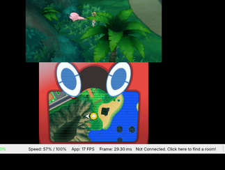

# Overworld Encounters

modern-style visible wild Pokémon in the tall grass of **Pokémon Ultra Moon**, as a 3GX
plugin for emulators with the Luma plugin loader (Azahar, Citra, Dekopon).



## Features

* Wild Pokémon pop out of the tall grass, stay for 12–22 seconds, then shrink away.
* They wander around their patch: a few steps, a stop, a look around, a few more steps.
* 1–2 Pokémon in small patches, 2–3 in medium ones and 3–5 in big ones.
* They always come from the encounter table of the patch you're standing in. Species, levels and
  slot rates are read live from the game, so randomized or edited encounter tables are shown
  correctly.
* Random grass encounters are turned off. Walk into a Pokémon to battle that exact Pokémon (same
  species, form and level). They never walk into you by themselves.
* Shiny Pokémon are visible in the overworld, and the battle Pokémon is shiny exactly when the
  overworld one was. The odds match the game's (1/4096 per roll, 3 rolls with the Shiny Charm).
* Pokémon cry now and then: when they pop out, stop or look around. Cries get quieter with distance
  and never overlap.
* They're shown slightly larger than in battle, and tiny species get an extra boost.
* Performance option: show them as 2D PC box icons instead of 3D models.

## Requirements

* Pokémon Ultra Moon (`00040000001B5100`) **with the v1.2 update** ("Ver. 1.2" on the title
  screen). Ultra Sun and the unpatched v1.0 are not supported yet.
* An emulator with the **3GX plugin loader** turned on: Azahar or Citra (Emulation → Configure →
  System), or Dekopon on Switch.
* **New 3DS mode** is recommended. In Old 3DS mode there is only memory for 1 Pokémon at a time.
  Dekopon: Settings → System → Console → New 3DS Mode (off by default).
* Only one `.3gx` loads per game, so remove other plugins from the same folder.

## Install

1. Download `OverworldEncounters.zip` from the [Releases](../../releases) page.
2. In Azahar, use **File → Open Azahar Folder** and open `sdmc` (create it if it's missing).
3. Copy the `luma` folder from the zip into `sdmc`, merging folders. You should end up with
   `sdmc/luma/plugins/00040000001B5100/OverworldEncounters.3gx`.
4. Fully restart the game. "Overworld Encounters ready" appears at the bottom of the top screen.
5. For the 2D icon mode, put `owe_icons.bin` next to the plugin. It's made from your own game:
   extract `romfs/a/0/6/2` (see `docs/RE_NOTES.md`) and run
   `python3 tools/make_icons.py a/0/6/2 owe_icons.bin`. It isn't included here, since it's game
   data.

## Menu

Press **Select** in game to open the plugin menu:

| Option | |
|---|---|
| Overworld encounters | On by default. Off = vanilla random encounters. |
| Pokemon cries | On by default. |
| Pokemon display | 3D models (default) or 2D icons: the PC box icons, much lighter (no models, no extra memory). |
| Big grass patches | Up to 5 Pokémon (default) or up to 3, lighter on performance. |
| Debug overlay | Internal state on the top screen. |
| Force spawn now | Spawns a Pokémon right away if you're in grass. |

A log is written next to the plugin (`owe_log.txt`). Please attach it to bug reports.

## Known limitations

* Pokémon wander slowly; they don't run away from you or chase you.
* Small Pokémon can be partly hidden by very tall grass.
* 2D icons are drawn on top of the picture, so they show through trees and other objects in front
  of them, and they don't show on the right eye in 3D.
* Battles start when you touch a Pokémon while walking (the game checks encounters on steps).
* Water, caves and other encounter types (surfing, fishing, SOS calls) are unchanged.
* Tested on emulators only, not on real hardware.

## Building

Linux, macOS or WSL with [devkitPro](https://devkitpro.org/wiki/Getting_Started) (devkitARM and
libctru), `git` and `python3`:

```sh
./scripts/get_ctrpf.sh   # once: downloads and builds CTRPluginFramework (pinned commit)
./plugin/build.sh        # -> plugin/build/OverworldEncounters.3gx
```

`DEVKITPRO` defaults to `/opt/devkitpro`. GitHub Actions builds every push with the
`devkitpro/devkitarm` container and attaches the zip to releases created from a tag (`v0.5`, …).

## How it works

* [`docs/DESIGN.md`](docs/DESIGN.md): architecture (hooks, spawning, wandering, cries, battles,
  model memory, lifetime rules).
* [`docs/RE_NOTES.md`](docs/RE_NOTES.md): every game address used, how each was found, and notes
  for porting the idea to other games (Omega Ruby / Alpha Sapphire in particular).
* [`tools/`](tools/): the reverse-engineering and test scripts.

In short: the plugin reuses the game's own Totem / Poké Finder model system to show battle
models in the field, reads the encounter table of the patch the player is in, and starts a normal
wild battle with that Pokémon when you touch it.

## Credits

* [CTRPluginFramework](https://gitlab.com/thepixellizeross/ctrpluginframework) by The Pixellizer
  Group (fetched at build time; its license is in `plugin/libctrpf/LICENSE.txt` after
  `get_ctrpf.sh`).
* devkitPro / libctru, the Luma3DS plugin loader, and the Azahar emulator team.

## Disclaimer

This is a fan project, not affiliated with or endorsed by Nintendo, Game Freak, Creatures Inc. or
The Pokémon Company. No game code or data is included: you need your own copy of the game.

## License

[MIT](LICENSE)
